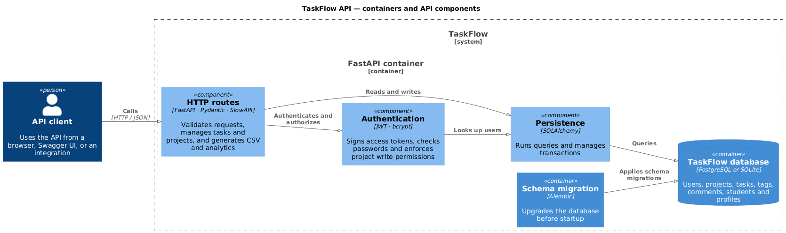

# TaskFlow Backend API

TaskFlow is a REST API for projects, tasks, assignments, tags, and comments.
It supports task filtering, project analytics and CSV export, plus a separate
student/profile example. Interactive OpenAPI documentation is at `/docs`.

## Architecture and stack



- **HTTP:** Python 3.12, FastAPI, Pydantic, Uvicorn, and SlowAPI.
- **Identity:** signed JWT access tokens and bcrypt password hashing.
- **Persistence:** SQLAlchemy with PostgreSQL 16 or SQLite; Alembic owns the schema.
- **Quality and packaging:** pytest, Ruff, mypy, GitHub Actions, and Docker Compose.

Request handlers validate input and delegate database operations to `app/crud.py`.
`app/dependencies.py` resolves the request principal and enforces project write
access. The API never creates tables on import. The [C4 source](docs/architecture.puml)
can be rendered with `java -jar plantuml.jar -tpng docs/architecture.puml`.

## Local setup (SQLite)

Prerequisites: Python 3.12, Git, and optionally Docker Engine with Docker Compose v2.

```sh
python3.12 -m venv .venv
. .venv/bin/activate
python -m pip install -r requirements-dev.txt
cp .env.example .env
python -c "import secrets; print(secrets.token_urlsafe(48))"
```

Set `SECRET_KEY` in `.env` to the generated value, then run:

```sh
alembic upgrade head
uvicorn app.main:app --reload --port 8000
```

Visit <http://localhost:8000/docs> or check `curl http://localhost:8000/health`.
For disposable SQLite development data, set `TASKFLOW_SEED_DEMO=1` and a
`TASKFLOW_SEED_PASSWORD` in `.env` and run `python seed.py` after migrating. It
creates the non-admin account `taskflow_demo` and a sample workspace if absent.

## Configuration

Process environment variables take precedence over `.env`. Keep real values out of Git.

| Variable | Default | Purpose |
| --- | --- | --- |
| `DATABASE_URL` | `sqlite:///./taskflow.db` | SQLAlchemy connection URL. Use `postgresql+psycopg://` for PostgreSQL. In the standalone image the SQLite default is `sqlite:////data/taskflow.db`; mount `/data` for persistence. |
| `SECRET_KEY` | Required | Random JWT signing key, printable ASCII without spaces. Minimum length: 32 for HS256, 48 for HS384, 64 for HS512. |
| `ALGORITHM` | `HS256` | HMAC algorithm: HS256, HS384, or HS512. |
| `ACCESS_TOKEN_EXPIRE_MINUTES` | `60` | Configurable token validity, from 1 to 1440 minutes. |
| `CORS_ALLOWED_ORIGINS` | Empty | Comma-separated browser origins, e.g. `https://app.example.com`. Empty means same-origin only. |
| `POSTGRES_PASSWORD` | Required for Compose | PostgreSQL login password; must match the password in the database URL. |
| `TASKFLOW_SEED_DEMO` | Disabled | Set to `1` to opt in to the local SQLite demo seed. |
| `TASKFLOW_SEED_PASSWORD` | Required for seed | Demo account password, 16–72 UTF-8 bytes. |

### Docker Compose (PostgreSQL)

Generate a separate password (`openssl rand -hex 24`). In `.env`, set
`POSTGRES_PASSWORD` and replace the SQLite URL with
`postgresql+psycopg://taskflow_user:<password>@db:5432/taskflow_db`, substituting
the same password. If the password contains URL-reserved characters,
percent-encode it in the URL only. Set `SECRET_KEY` separately.

```sh
docker compose up -d --build --wait
curl --fail http://127.0.0.1:8000/projects
docker compose down
```

Compose starts PostgreSQL, runs a one-shot `alembic upgrade head`, then starts
the non-root API. PostgreSQL is not published to the host; the API binds to
loopback. Use a local reverse proxy or an explicit deployment override to
publish it. Plain `docker compose down` preserves the database volume.

### Upgrading an existing deployment

1. Back up the database. Rotate the previous signing key and any previously
   hardcoded PostgreSQL credential that was used. Changing
   `POSTGRES_PASSWORD` does not rotate an existing database role: update the
   role separately and update both environment settings together.
2. Check `alembic current`. For an already-versioned database, run
   `alembic upgrade head` before starting the new API. There is no new revision;
   the repaired initial migration now works on an empty database.
3. If the old API created tables without an Alembic revision, **do not run
   `upgrade head` or stamp blindly**. Compare the existing schema (including
   indexes and foreign keys) against a fresh database migrated to head. Only
   after confirming they match, run `alembic stamp head` and `alembic check`.
   Reconcile mismatched schemas separately on a backup copy first.
4. Require clients to sign in again after key rotation. New passwords over
   72 UTF-8 bytes are rejected rather than truncated; clients that used
   overlong legacy passwords must use the original first 72 bytes if that is
   valid UTF-8, or have an operator reset the password. Review and disable
   accounts provisioned by the old demo seed outside development.

## API behavior

Register at `POST /auth/register`, exchange JSON or form credentials at
`POST /auth/login`, and send `Authorization: Bearer <token>` to authenticated
routes such as `GET /auth/me` or `GET /tasks/my-tasks`. Project creation with a token
sets the owner. Only the owner or a superuser can update or delete an owned
project, edit its tasks, change their tag assignments, or delete their comments.
Tags attached to any owned project must be unassigned before global deletion.

This remains a shared demo API, **not a private multi-tenant service**: project
and task reads, metrics, CSV exports, guest comments, the global tag catalog,
and the student/profile example remain public. Projects created anonymously
remain writable by anyone. Use a trusted environment and do not store
sensitive or personal data on a publicly reachable instance.

Use `GET /projects/paginated` for paginated project lists, `GET /tasks` for
task search and filters, and `GET /projects/{id}/export/csv` to export tasks.
See `/docs` for the full set of endpoints and payloads.

## Checks

```sh
ruff check app tests alembic seed.py
mypy app
python -m pytest -q
alembic check
```

CI runs lint, type checks, the test suite, SQLite migration verification, and
a PostgreSQL Compose build and smoke test on every push and pull request.
